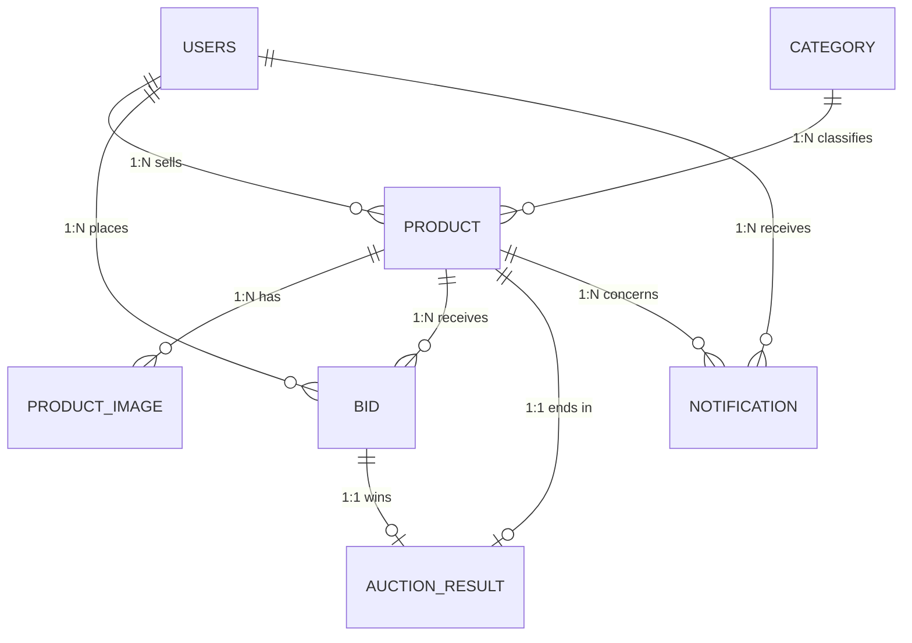

# 🏛️ Onlayn Açıq-Artırma və Hərrac İdarəetmə Sistemi
### (Online Auction Management System - Capstone Project)


---

## 📌 Layihə Haqqında (Project Overview)

Bu layihə **Verilənlər Bazasının İdarəetmə Sistemləri (VBİS)** fənni üzrə hazırlanmış **Capstone Layihəsi**dir. Sistem klassik alqı-satqı və ənənəvi fiziki hərracların çatışmazlıqlarını (coğrafi məhdudiyyət, saxta təkliflər, vaxtın qeyri-müəyyən uzadılması) aradan qaldıran mərkəzləşdirilmiş, təhlükəsiz və tam avtomatlaşdırılmış **Onlayn Açıq-Artırma Platforması**dır.

Layihə 3 mərhələ üzrə tam layihələndirilmiş və reallaşdırılmışdır:
* **Mərhələ 1 (Milestone 1):** Problemin analizi, biznes qaydaları (BR-1 ... BR-11) və funksional tələblərin müəyyənləşdirilməsi.
* **Mərhələ 2 (Milestone 2):** Konseptual və məntiqi dizayn (ERD Crow's Foot, 3NF / BCNF normallaşdırma, relyasion model).
* **Mərhələ 3 (Milestone 3):** Fiziki verilənlər bazası (`PostgreSQL`), tam məhdudiyyətlər (PK, FK, CHECK, UNIQUE), biznes qaydalarını qoruyan PL/pgSQL təhlükəsizlik triggerləri, analitik VIEW-lər və rəsmi hesabat sənədləri.

---

## 📁 Milestone 3 Təqdimat Faylları (Submission Deliverables)

Bütün tələb olunan fayllar [`capstone_m3/`](./capstone_m3/) qovluğunda və ana dizində səliqəli şəkildə yerləşdirilmişdir:

| Fayl | Təsviri |
| :--- | :--- |
| 📄 [`Milestone3_Report.pdf`](./capstone_m3/Milestone3_Report.pdf) | **Rəsmi PDF Hesabatı** (Database Overview, Data Dictionary, Type Justification, Validation, Problems & Solutions, Bonus) |
| 📝 [`Milestone3_Report.docx`](./capstone_m3/Milestone3_Report.docx) | **Microsoft Word Formatında Hesabat** (Redaktə edilə bilən format) |
| 💾 [`schema.sql`](./capstone_m3/schema.sql) | **Bütün DDL əmrləri** (`auction_core` sxemi, 7 cədvəl, PK/FK/CHECK məhdudiyyətləri, PL/pgSQL triggerləri və VIEW-lər) |
| 💾 [`insert.sql`](./capstone_m3/insert.sql) | **DML Test Məlumatları** (Hər əsas cədvəldə minimum 10 qeyd təmin olunmuşdur) |

---

## 🏗️ Verilənlər Bazasının Arxitekturası və Cədvəllər

Verilənlər bazası **PostgreSQL** mühərrikində, xüsusi `auction_core` sxemi daxilində və 3NF normal formasında qurulmuşdur:



1. **`users` (12 test qeydi):** İstifadəçilər (Admin, Satıcı, Alıcı), cüzdan depozit balansı (`deposit_balance`) və etibarlılıq balı (`reputation_score`).
2. **`category` (10 test qeydi):** Məhsul kateqoriyaları (Elektronika, Avtomobillər, Zərgərlik, Məişət və s.).
3. **`product` (10 test qeydi):** Hərrac elanları, başlanğıc qiymət, minimum artım addımı, dəqiq bitmə vaxtı (`end_time`) və status (`ACTIVE`, `CLOSED`, `CANCELLED`).
4. **`product_image` (12 test qeydi):** Məhsul şəkilləri və sıra nömrəsi (`1:N` əlaqə, `ON DELETE CASCADE`).
5. **`bid` (18 test qeydi):** Verilən bütün təkliflərin dəyişməz xronoloji tarixçəsi (`M:N` əlaqənin həlli).
6. **`auction_result` (2 test qeydi):** Başa çatmış hərracın 1:1 qalibiyyət nəticəsi və qalib təklif (`winning_bid_id`).
7. **`notification` (10 test qeydi):** Qalibiyyət (`WON`), məğlubiyyət (`LOST`), təklifin keçilməsi (`OUTBID`) və yeni təklif (`NEW_BID`) bildirişləri.

---

## ⚡ Tətbiq Olunmuş Qabaqcıl Xüsusiyyətlər və Bonuslar (+5 Bal)

* ✅ **PostgreSQL Schema:** Məlumat təcridi üçün `auction_core` sxemi (`CREATE SCHEMA IF NOT EXISTS auction_core;`).
* ✅ **Müasir Sequence və Identity:** `BIGINT GENERATED ALWAYS AS IDENTITY PRIMARY KEY`.
* ✅ **Biznes Qaydası və Təhlükəsizlik Triggerləri:**
  * `trg_validate_and_place_bid`: 
    * Satıcının öz məhsuluna təklif verməsini qadağan edir (**BR-2**).
    * Vaxtı bitmiş hərraca təklif verilməsini bloklayır (**BR-7**).
    * Lider alıcının öz təklifinin üstünə ardıcıl təklif verməsini əngəlləyir (**BR-8**).
    * Təklifin cari qiymət + minimum artım addımından az olmasını bloklayır (**BR-4**).
    * Uğurlu təklifdən sonra `product.current_price` sahəsini avtomatik sinxronlaşdırır.
  * `trg_prevent_end_time_change`: Hərracın bitmə vaxtının dəyişdirilməsini qadağan edir (**BR-6**).
* ✅ **Analitik Görünüşlər (Views):**
  * `v_active_auctions`: Aktiv elanlar, qalan saatlar, kateqoriya və cari ən yüksək təklif.
  * `v_auction_winners`: Yekunlaşmış hərraclar, qalib alıcılar və yekun satış qiymətləri.
  * `v_user_bidding_summary`: İstifadəçilərin cüzdan və auksion fəallığı icmalı.

---

## 🚀 Quraşdırma və İşə Salma (Setup & Execution)

### 1. Verilənlər Bazasını Quraşdırmaq (PostgreSQL)
PostgreSQL terminalında (`psql`) və ya pgAdmin-də:
```sql
CREATE DATABASE online_auction_db;
\c online_auction_db;

-- 1. Sxem, cədvəllər, constraint-lər, triggerlər və view-ləri yaradın:
\i schema.sql

-- 2. Test məlumatlarını daxil edin:
\i insert.sql
```

### 2. Django Veb Tətbiqini İşə Salmaq
```bash
# Asılılıqları quraşdırın
pip install -r requirements.txt # və ya pip install django psycopg2-binary python-dotenv

# Serveri başladın
python manage.py runserver
```
Brauzerdə `http://127.0.0.1:8000/` ünvanını açın.

---

## 👥 Test İstifadəçi Hesabları (Giriş üçün)

Bütün test hesablarının şifrəsi: **`password123`**
* **Admin:** `admin` / `admin123Qazx` (Balans: 1000 ₼)
* **Satıcılar:** `elmir_ramazanov`, `kerim_hasanov`, `ali_aliyev`, `rahman_islamzade` (Hər biri 1000 ₼)
* **Alıcılar:** `ali_shukurlu`, `rasim_xalilov`, `nurlan_resulzade`, `necef_hesenaliyev` (Hər biri 1000 ₼)

---

## 👨‍💻 Müəllif
* **Tələbə:** Əli Əliyev
* **Fənn:** Verilənlər Bazasının İdarəetmə Sistemləri (VBİS)
* **Layihə:** Capstone Project — Milestone 3
